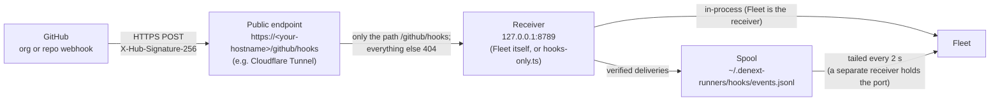

# Webhooks (optional)

Fleet works without webhooks: it polls the GitHub API and shows the same jobs, runs and runners.
Webhooks make it faster and cheaper. This guide sets them up from scratch on Fleet's three
platforms: macOS on Apple Silicon (arm64), Linux x64 and Windows x64.

> **Platform status.** Every step below is written for all three operating systems. Today the code
> receives webhooks **on macOS only**. Steps marked **"Planned for 1.0 — not working yet on Linux /
> Windows"** describe how the setup will work once that support lands; following them now leaves
> Fleet on `hooks: off` (polling), which is harmless. See [What works today](#what-works-today) for
> the exact limits.

## Contents

- [What webhooks add](#what-webhooks-add)
- [How it fits together](#how-it-fits-together)
- [What works today](#what-works-today)
- [Prerequisites](#prerequisites)
- [Step 1: the webhook secret](#step-1-the-webhook-secret)
- [Step 2: the receiver](#step-2-the-receiver)
- [Step 3: a public HTTPS endpoint](#step-3-a-public-https-endpoint)
- [Step 4: the GitHub webhook](#step-4-the-github-webhook)
- [Step 5: verify](#step-5-verify)
- [Troubleshooting](#troubleshooting)
- [Security notes](#security-notes)
- [Rotating the secret](#rotating-the-secret)
- [Removing everything](#removing-everything)

## What webhooks add

- **Instant updates.** A job queued, started or finished shows up in Fleet within a second or two
  instead of on the next poll (every 15 s with the window visible, 60 s hidden, slower when the rate
  budget is low).
- **Fewer API calls.** While deliveries arrive, polling drops to one reconciliation every 5 minutes.
  The REST budget (5,000 requests an hour per token) is often shared with other tools; webhooks
  leave most of it to them.
- **A back-fill.** Every verified delivery is appended to a local spool file. When Fleet starts, it
  fills its event log with what happened while it was closed (the last 24 h, at most 500 lines,
  marked ↺).

Polling stays on as the safety net: if no delivery arrives for 10 minutes while runs are active,
Fleet goes back to its normal poll rate. A missed delivery or a dead tunnel costs freshness, never
correctness.

**What is sent where.** GitHub sends `workflow_job` and `workflow_run` events (JSON describing a job
or run: repository, workflow and job names, status, timestamps, runner name) to the public URL you
configure. Your tunnel provider forwards them to a receiver on your own machine, which listens on
the loopback address only. Nothing leaves your machine: the receiver never calls out, and the
webhook secret is shared only with GitHub.

## How it fits together



The same in text:

```
GitHub ──HTTPS──▶ https://<your-hostname>/github/hooks   (tunnel / reverse proxy, TLS)
                        │  only POST /github/hooks passes; any other path: 404
                        ▼
                  http://127.0.0.1:8789/github/hooks      (receiver, loopback only)
                        │  checks route, type, size, signature, replay, duplicates
                        ▼
                  ~/.denext-runners/hooks/events.jsonl    (spool, 0600, rotated at 20 MB)
                        │
                        ▼
                      Fleet                               ("hooks: live")
```

### The receiver

The receiver is the same code in two places:

- **Inside Fleet.** When Fleet starts and the webhook setup is present (see
  [What works today](#what-works-today)), it tries to listen on `127.0.0.1:8789`. If it gets the
  port, it is the receiver: deliveries go straight into its state and are also appended to the
  spool. The header shows `hooks: live`.
- **Standalone, `hooks-only.ts`.** A small process with no window, run as a background service. It
  holds the port and writes the spool. When Fleet starts and finds the port taken, it tails the
  spool every 2 s instead and shows `hooks: live (via receiver)`. If the port is taken and there is
  no spool, Fleet stays on polling (`hooks: off`).

Run the standalone receiver if you want deliveries recorded while Fleet is closed (the back-fill
needs them) or if other tools read the spool. Running only Fleet is fine too; deliveries that arrive
while it is closed are simply missed, and polling catches up.

### What the receiver checks

In this order, before anything in the body is parsed:

| Check                                                                                                         | On failure                     |
| ------------------------------------------------------------------------------------------------------------- | ------------------------------ |
| Method and path are exactly `POST /github/hooks`                                                              | `404 not found`                |
| `Content-Type` is `application/json`                                                                          | `415`                          |
| Body is at most 1 MiB (a larger `Content-Length` is refused unread; a longer stream is cut off)               | `413 body too large`           |
| `X-Hub-Signature-256` equals `sha256=` + HMAC-SHA256 of the raw body under the secret (constant-time compare) | `401 rejected signature`       |
| Event is `ping`                                                                                               | `200 pong`                     |
| Event is not `workflow_job` / `workflow_run`                                                                  | `202 ignored`                  |
| `X-GitHub-Delivery` missing                                                                                   | `202 no delivery id`           |
| Delivery id seen before (the last 10,000, reloaded from the spool at start)                                   | `202 duplicate`                |
| Body is not a JSON object                                                                                     | `400 bad json`                 |
| The job's or run's newest timestamp is over 10 minutes old (a replay, or hopelessly late)                     | `202 stale` (not spooled)      |
| Otherwise                                                                                                     | `202 accepted`, spooled, shown |

Payloads are data only: nothing in one is run, fetched or passed to a shell. The response goes out
before processing (GitHub waits at most 10 s; the receiver answers in well under one).

## What works today

| Piece                                                          | macOS | Linux        | Windows      |
| -------------------------------------------------------------- | ----- | ------------ | ------------ |
| Secret in the OS credential store                              | yes   | planned, 1.0 | planned, 1.0 |
| Receiver inside Fleet                                          | yes   | planned, 1.0 | planned, 1.0 |
| Standalone receiver (`hooks-only.ts`) as a service             | yes   | planned, 1.0 | planned, 1.0 |
| Spool file and Fleet tailing it                                | yes   | planned, 1.0 | planned, 1.0 |
| Cloudflare Tunnel (or another endpoint) as a service           | yes   | yes          | yes          |
| GitHub webhook, verification with `curl` and Recent Deliveries | yes   | yes          | yes          |

Current requirements and fixed values, all set in code (they become settings with the 1.0 setup
wizard):

- **Fleet only turns webhooks on when a launchd job file for the tunnel exists** under the label in
  `TUNNEL_LABEL` (`lib/deno-hooks.ts`). Fleet checks only that the `.plist` file exists, in
  `~/Library/LaunchAgents/`, `/Library/LaunchAgents/` or `/Library/LaunchDaemons/`; it doesn't check
  that the tunnel runs or which tunnel it is. Below, `<tunnel-label>` means that exact value.
  `cloudflared service install` uses a different label, so on macOS run the tunnel with the plist in
  [Step 3](#run-the-tunnel-as-a-service) instead.
- **The secret is read from the macOS login keychain** by `/usr/bin/security`: service
  `denext-ci-hooks`, account `github-webhook-secret`.
- **The port is 8789 and the path is `/github/hooks`.** Neither is configurable.
- **The spool is `~/.denext-runners/hooks/`** (from `$HOME`).
- **Fleet polls one organization**, the one in `ORG` (`lib/pools.ts`). Deliveries are applied for
  whatever repository they name, so point the webhook at that same organization (or its
  repositories) to keep webhooks and polling in agreement.
- **A packaged Fleet may write the spool only at the path baked in at build time** (the builder's
  `$HOME`). Build Fleet on the account that runs it, or run the standalone receiver (Fleet then only
  reads the spool).

## Prerequisites

- A **GitHub organization you own** (or a repository you admin) whose Actions Fleet watches.
- **`gh`**, the GitHub CLI, signed in with the `admin:org_hook` scope for an organization webhook
  (`gh auth refresh -h github.com -s admin:org_hook`), or `admin:repo_hook` for a repository
  webhook. A fine-grained token needs the organization (or repository) permission **Webhooks: read
  and write**. You can also do Step 4 in the browser as an organization owner.
- **Deno** 2.x for the standalone receiver (`deno --version`), and a checkout of Fleet's source.
- **A domain on Cloudflare** (free plan is enough) for the Cloudflare Tunnel walkthrough, or another
  way to give your machine a public HTTPS URL ([alternatives](#alternatives-to-cloudflare-tunnel)).
- **`openssl`** to generate the secret (macOS and most Linux distributions have it; on Windows it
  ships with Git for Windows, or use the PowerShell line below).
- **A correct clock** (automatic network time). The replay check drops deliveries whose timestamps
  look over 10 minutes old.
- `jq` for the `gh api` examples (optional).

Placeholders used below:

| Placeholder        | Meaning                                                    | Example                         |
| ------------------ | ---------------------------------------------------------- | ------------------------------- |
| `<org>`            | your GitHub organization                                   | `example-org`                   |
| `<owner>/<repo>`   | a repository, for a repository-level webhook               | `example-org/app`               |
| `<your-hostname>`  | the public host name GitHub will call                      | `ci-hooks.example.com`          |
| `<tunnel-name>`    | the Cloudflare Tunnel's name                               | `fleet-hooks`                   |
| `<tunnel-id>`      | the tunnel's UUID, printed by `cloudflared tunnel create`  | `6ff42ae2-…`                    |
| `<tunnel-label>`   | the launchd label Fleet checks for (`TUNNEL_LABEL`, macOS) | (see `lib/deno-hooks.ts`)       |
| `<receiver-label>` | your label for the standalone receiver's service           | `com.example.fleet-hooks`       |
| `<fleet-checkout>` | the absolute path of Fleet's source folder                 | `/Users/you/src/fleet`          |
| `<deno>`           | the absolute path of `deno` (`which deno` / `where deno`)  | `/opt/homebrew/bin/deno`        |
| `<cloudflared>`    | the absolute path of `cloudflared`                         | `/opt/homebrew/bin/cloudflared` |
| `<user>`, `<home>` | your user name and home folder                             | `you`, `/Users/you`             |

## Step 1: the webhook secret

GitHub signs every delivery with a shared secret; the receiver refuses anything not signed with it.
Use a random value of **at least 32 characters** (Fleet refuses a shorter one and stays on polling).
64 hex characters is a good choice.

Generate it:

```sh
openssl rand -hex 32
```

On Windows without OpenSSL (PowerShell; a cryptographically strong generator):

```powershell
$b = New-Object byte[] 32; [Security.Cryptography.RandomNumberGenerator]::Create().GetBytes($b); -join ($b | ForEach-Object { $_.ToString('x2') })
```

Keep it out of files, chat and shell history. You need it in two places only: the OS credential
store (now) and GitHub (Step 4, read back from the store).

### macOS: the login keychain

Store it with the `security` tool itself, so the receiver's later reads with `/usr/bin/security`
don't raise a keychain prompt (a background service can't answer one). With `-w` last and no value,
`security` prompts for the secret (paste it twice), so it never lands in your shell history:

```sh
security add-generic-password -U -s denext-ci-hooks -a github-webhook-secret -l "Fleet webhook secret" -w
```

Check that it exists (prints the item's attributes, not the secret):

```sh
security find-generic-password -s denext-ci-hooks -a github-webhook-secret >/dev/null && echo stored
```

Use the **login** keychain (the default) and run the receiver as a **LaunchAgent** of the same user
(Step 2), which runs after you log in, when that keychain is unlocked.

### Linux: the Secret Service (GNOME Keyring, KWallet)

**Planned for 1.0 — not working yet on Linux.** Fleet doesn't read a secret on Linux today. The
planned store is the Secret Service, with the same service and account names. Store it with
`secret-tool` (package `libsecret-tools` on Debian/Ubuntu, `libsecret` on Fedora), which prompts for
the value:

```sh
secret-tool store --label="Fleet webhook secret" service denext-ci-hooks account github-webhook-secret
secret-tool lookup service denext-ci-hooks account github-webhook-secret >/dev/null && echo stored
```

The keyring must be unlocked in the session that runs the receiver (a desktop login unlocks it).

### Windows: Credential Manager

**Planned for 1.0 — not working yet on Windows.** Fleet doesn't read a secret on Windows today. The
planned store is Windows Credential Manager, a generic credential named `denext-ci-hooks` with user
`github-webhook-secret`. With `/pass` and no value, `cmdkey` prompts for it:

```powershell
cmdkey /generic:denext-ci-hooks /user:github-webhook-secret /pass
cmdkey /list:denext-ci-hooks
```

## Step 2: the receiver

Choose one:

- **Fleet alone.** Nothing to install: once the secret and the tunnel's service file exist, Fleet
  listens on `127.0.0.1:8789` itself while it runs. Skip to
  [Step 3](#step-3-a-public-https-endpoint).
- **The standalone receiver** (recommended): `hooks-only.ts` runs as a background service, always
  on, and Fleet reads its spool. Deliveries are recorded while Fleet is closed.

Only one process can hold port 8789. Don't run the standalone receiver and expect Fleet to listen
too; Fleet notices and tails the spool.

Try the standalone receiver in a terminal first, from the Fleet checkout (macOS):

```sh
cd <fleet-checkout>
deno task hooks
```

It exits with `hooks: not this machine` until both the secret (Step 1) and the tunnel's launchd file
(Step 3) exist. Once running, it prints `hooks: listening on http://127.0.0.1:8789/github/hooks` and
then one line per delivery (time, event, action, repository, job or run name, status), never the
secret, headers or a body. Stop it with Ctrl+C before installing the service.

The service needs only these Deno permissions: listen on `127.0.0.1:8789`, run the secret tool, read
`HOME`, read the tunnel's service file and the spool folder, write the spool folder.

### macOS: a launchd agent

Save as `~/Library/LaunchAgents/<receiver-label>.plist`:

```xml
<?xml version="1.0" encoding="UTF-8"?>
<!DOCTYPE plist PUBLIC "-//Apple//DTD PLIST 1.0//EN" "http://www.apple.com/DTDs/PropertyList-1.0.dtd">
<plist version="1.0">
<dict>
  <key>Label</key>
  <string><receiver-label></string>
  <key>ProgramArguments</key>
  <array>
    <string><deno></string>
    <string>run</string>
    <string>--allow-net=127.0.0.1:8789</string>
    <string>--allow-run=/usr/bin/security</string>
    <string>--allow-env=HOME</string>
    <string>--allow-read=<home>/Library/LaunchAgents/<tunnel-label>.plist,/Library/LaunchDaemons/<tunnel-label>.plist,/Library/LaunchAgents/<tunnel-label>.plist,<home>/.denext-runners/hooks</string>
    <string>--allow-write=<home>/.denext-runners/hooks</string>
    <string>hooks-only.ts</string>
  </array>
  <key>WorkingDirectory</key>
  <string><fleet-checkout></string>
  <key>EnvironmentVariables</key>
  <dict>
    <key>HOME</key>
    <string><home></string>
  </dict>
  <key>RunAtLoad</key>
  <true/>
  <key>KeepAlive</key>
  <true/>
  <key>ThrottleInterval</key>
  <integer>10</integer>
  <key>StandardOutPath</key>
  <string><home>/Library/Logs/fleet-hooks/receiver.log</string>
  <key>StandardErrorPath</key>
  <string><home>/Library/Logs/fleet-hooks/receiver.log</string>
</dict>
</plist>
```

Load it (after Step 3, so the tunnel's file exists; until then the receiver exits and launchd
retries every 10 s):

```sh
mkdir -p ~/Library/Logs/fleet-hooks
plutil -lint ~/Library/LaunchAgents/<receiver-label>.plist
launchctl bootstrap gui/$(id -u) ~/Library/LaunchAgents/<receiver-label>.plist
launchctl print gui/$(id -u)/<receiver-label> | grep -E 'state|last exit'
tail -f ~/Library/Logs/fleet-hooks/receiver.log
```

Restart it (needed after a secret change): `launchctl kickstart -k gui/$(id -u)/<receiver-label>`.
Stop it: `launchctl bootout gui/$(id -u)/<receiver-label>`.

### Linux: a systemd user unit

**Planned for 1.0 — not working yet on Linux.** Today the receiver exits with
`hooks: not this machine` on Linux. The unit below is the planned setup; the exact `--allow-run`
(the secret helper) and `--allow-read` (the tunnel check) will match the 1.0 code. Save as
`~/.config/systemd/user/fleet-hooks.service`:

```ini
[Unit]
Description=Fleet GitHub webhook receiver (127.0.0.1:8789)
After=network-online.target

[Service]
WorkingDirectory=<fleet-checkout>
ExecStart=<deno> task hooks
Restart=always
RestartSec=10
# Logs: journalctl --user -u fleet-hooks

[Install]
WantedBy=default.target
```

```sh
systemctl --user daemon-reload
systemctl --user enable --now fleet-hooks.service
systemctl --user status fleet-hooks.service
journalctl --user -u fleet-hooks -f
```

A user unit runs while you are logged in, which is also when the keyring is unlocked. Restart it
after a secret change: `systemctl --user restart fleet-hooks`.

### Windows: a scheduled task at logon

**Planned for 1.0 — not working yet on Windows.** Today the receiver exits with
`hooks: not this machine` on Windows. The planned setup runs it as a scheduled task of your own user
at logon (a Windows service runs as another account and can't read your Credential Manager entry).
In PowerShell:

```powershell
$action  = New-ScheduledTaskAction -Execute "<deno>" -Argument "task hooks" -WorkingDirectory "<fleet-checkout>"
$trigger = New-ScheduledTaskTrigger -AtLogOn -User "$env:USERNAME"
$settings = New-ScheduledTaskSettingsSet -RestartCount 999 -RestartInterval (New-TimeSpan -Minutes 1) `
  -ExecutionTimeLimit ([TimeSpan]::Zero) -StartWhenAvailable -AllowStartIfOnBatteries -DontStopIfGoingOnBatteries
Register-ScheduledTask -TaskName "Fleet webhook receiver" -Action $action -Trigger $trigger -Settings $settings
Start-ScheduledTask -TaskName "Fleet webhook receiver"
Get-ScheduledTaskInfo -TaskName "Fleet webhook receiver"
```

Restart it after a secret change: `Stop-ScheduledTask` then `Start-ScheduledTask` with the same
name. The spool will be `%USERPROFILE%\.denext-runners\hooks\events.jsonl`.

## Step 3: a public HTTPS endpoint

GitHub must reach the receiver over HTTPS at `https://<your-hostname>/github/hooks`. The receiver
listens on loopback only, so something on your machine has to carry requests in. A tunnel does this
without opening a port on your router and with a valid TLS certificate.

**Expose only the one path.** Route only `/github/hooks` to the receiver and answer everything else
at the edge with 404. The receiver would refuse other paths anyway, but filtering at the edge keeps
scanners and stray traffic off your machine entirely.

### Cloudflare Tunnel

You need a domain whose DNS is on Cloudflare. The tunnel makes an outbound connection to Cloudflare;
nothing listens publicly on your machine.

#### Install cloudflared

macOS on Apple Silicon (Homebrew):

```sh
brew install cloudflared
cloudflared --version
```

Linux x64 (Debian / Ubuntu):

```sh
curl -fsSLo /tmp/cloudflared.deb https://github.com/cloudflare/cloudflared/releases/latest/download/cloudflared-linux-amd64.deb
sudo dpkg -i /tmp/cloudflared.deb
cloudflared --version
```

Linux x64 (Fedora / RHEL): the same with `cloudflared-linux-x86_64.rpm` and `sudo rpm -i`.
Cloudflare also publishes apt and dnf repositories that keep it updated; see Cloudflare's
"Downloads" page for cloudflared.

Windows x64 (PowerShell):

```powershell
winget install --id Cloudflare.cloudflared
cloudflared --version
```

#### Log in, create the tunnel, add the DNS record

The same on every OS:

```sh
cloudflared tunnel login                       # opens a browser; pick the domain; writes cert.pem
cloudflared tunnel create <tunnel-name>        # prints the tunnel id; writes <tunnel-id>.json
cloudflared tunnel route dns <tunnel-name> <your-hostname>   # a proxied CNAME to the tunnel
```

These write to the cloudflared folder: `~/.cloudflared/` on macOS and Linux,
`%USERPROFILE%\.cloudflared\` on Windows.

- `cert.pem` is an account certificate that can create and delete tunnels and DNS records. It is
  needed only for these management commands, not to run the tunnel; keep it private, or delete it
  once set up (run `cloudflared tunnel login` again when you need it).
- `<tunnel-id>.json` is the tunnel's credentials file: whoever has it can run your tunnel. Keep it
  readable by you only: `chmod 400 ~/.cloudflared/<tunnel-id>.json` (macOS, Linux); on Windows it is
  in your profile, which other standard users can't read.

#### config.yml with the path-only rule

Create a folder for this tunnel's config, for example `~/.cloudflared/<tunnel-name>/config.yml`
(Windows: `%USERPROFILE%\.cloudflared\<tunnel-name>\config.yml`):

```yaml
# GitHub webhook -> Fleet's receiver. Only POSTs to /github/hooks reach this machine
# (loopback only); everything else is a 404 at Cloudflare's edge.
tunnel: <tunnel-id>
credentials-file: <home>/.cloudflared/<tunnel-id>.json
no-autoupdate: true
ingress:
  - hostname: <your-hostname>
    path: ^/github/hooks$
    service: http://127.0.0.1:8789
    originRequest:
      connectTimeout: 10s
      noHappyEyeballs: true
  - service: http_status:404
```

- `path` is a regular expression matched against the request path; the anchors make it exactly
  `/github/hooks`.
- The last rule is the catch-all every cloudflared config needs: any other host or path gets a 404
  from Cloudflare without reaching your machine.
- `127.0.0.1` rather than `localhost` avoids an IPv6 `::1` attempt (the receiver is IPv4 loopback).
- On Windows write paths as `C:\Users\<user>\.cloudflared\<tunnel-id>.json`.

Check it, then run it once in the foreground:

```sh
cloudflared tunnel --config ~/.cloudflared/<tunnel-name>/config.yml ingress validate
cloudflared tunnel --config ~/.cloudflared/<tunnel-name>/config.yml ingress rule https://<your-hostname>/github/hooks
cloudflared tunnel --config ~/.cloudflared/<tunnel-name>/config.yml run
```

`ingress rule` should print the rule pointing at `http://127.0.0.1:8789`. Stop the foreground run
with Ctrl+C once `run` reports registered connections.

#### Run the tunnel as a service

**macOS: a launchd agent under `<tunnel-label>`.** Fleet turns webhooks on only when this file
exists (see [What works today](#what-works-today)), so use this plist rather than
`cloudflared service install`. Save as `~/Library/LaunchAgents/<tunnel-label>.plist`:

```xml
<?xml version="1.0" encoding="UTF-8"?>
<!DOCTYPE plist PUBLIC "-//Apple//DTD PLIST 1.0//EN" "http://www.apple.com/DTDs/PropertyList-1.0.dtd">
<plist version="1.0">
<dict>
  <key>Label</key>
  <string><tunnel-label></string>
  <key>ProgramArguments</key>
  <array>
    <string><cloudflared></string>
    <string>tunnel</string>
    <string>--config</string>
    <string><home>/.cloudflared/<tunnel-name>/config.yml</string>
    <string>run</string>
  </array>
  <key>RunAtLoad</key>
  <true/>
  <key>KeepAlive</key>
  <true/>
  <key>ThrottleInterval</key>
  <integer>10</integer>
  <key>StandardOutPath</key>
  <string><home>/Library/Logs/fleet-hooks/tunnel.log</string>
  <key>StandardErrorPath</key>
  <string><home>/Library/Logs/fleet-hooks/tunnel.log</string>
</dict>
</plist>
```

```sh
mkdir -p ~/Library/Logs/fleet-hooks
launchctl bootstrap gui/$(id -u) ~/Library/LaunchAgents/<tunnel-label>.plist
tail -f ~/Library/Logs/fleet-hooks/tunnel.log     # look for "Registered tunnel connection"
```

**Linux: a systemd user unit.** (The tunnel itself works on Linux today; Fleet's use of it is
**planned for 1.0**.) Save as `~/.config/systemd/user/fleet-hooks-tunnel.service`:

```ini
[Unit]
Description=Cloudflare Tunnel for Fleet webhooks
After=network-online.target

[Service]
ExecStart=<cloudflared> tunnel --config <home>/.cloudflared/<tunnel-name>/config.yml run
Restart=always
RestartSec=10

[Install]
WantedBy=default.target
```

```sh
systemctl --user daemon-reload
systemctl --user enable --now fleet-hooks-tunnel.service
journalctl --user -u fleet-hooks-tunnel -f
```

To keep it running while you are logged out, `sudo loginctl enable-linger <user>`. Alternatively
`sudo cloudflared service install` creates a system unit that reads `/etc/cloudflared/config.yml`
(copy the config and the credentials file there and fix `credentials-file`).

**Windows: a scheduled task at logon.** (The tunnel works on Windows today; Fleet's use of it is
**planned for 1.0**.) In PowerShell:

```powershell
$action  = New-ScheduledTaskAction -Execute "<cloudflared>" `
  -Argument "tunnel --config `"$env:USERPROFILE\.cloudflared\<tunnel-name>\config.yml`" run"
$trigger = New-ScheduledTaskTrigger -AtLogOn -User "$env:USERNAME"
$settings = New-ScheduledTaskSettingsSet -RestartCount 999 -RestartInterval (New-TimeSpan -Minutes 1) `
  -ExecutionTimeLimit ([TimeSpan]::Zero) -StartWhenAvailable -AllowStartIfOnBatteries -DontStopIfGoingOnBatteries
Register-ScheduledTask -TaskName "Fleet webhook tunnel" -Action $action -Trigger $trigger -Settings $settings
Start-ScheduledTask -TaskName "Fleet webhook tunnel"
```

Or as a Windows service, from an elevated prompt: `cloudflared service install`. The service runs as
LocalSystem and reads its config from `C:\Windows\System32\config\systemprofile\.cloudflared\`, so
copy `config.yml` and the credentials file there and point `credentials-file` at the copy.

### Alternatives to Cloudflare Tunnel

Any of these work as long as GitHub gets a stable HTTPS URL and only `/github/hooks` is forwarded to
`http://127.0.0.1:8789`:

- **ngrok**: a reserved domain (`ngrok http 127.0.0.1:8789 --url=<your-hostname>`) plus a traffic
  policy that denies every path but `/github/hooks`. A free random URL changes on restart, which
  breaks the webhook.
- **Tailscale Funnel**:
  `tailscale funnel --bg --set-path /github/hooks http://127.0.0.1:8789/github/hooks` publishes only
  that path at `https://<machine>.<tailnet>.ts.net/github/hooks`.
- **Your own reverse proxy** (Caddy, nginx) on a host with a public address and a TLS certificate:
  proxy only `POST /github/hooks` to the receiver and return 404 for the rest. The receiver binds
  loopback only, so the proxy must run on the same machine.

On macOS, Fleet still requires the `<tunnel-label>` launchd file today, whatever carries the
traffic. Run your alternative's agent under that label (the plist above with its command), or create
the file with that label for the agent you already run.

## Step 4: the GitHub webhook

An **organization** webhook covers every repository in it (recommended). A **repository** webhook
covers one; add one per repository.

Settings for either:

| Field            | Value                                                                           |
| ---------------- | ------------------------------------------------------------------------------- |
| Payload URL      | `https://<your-hostname>/github/hooks`                                          |
| Content type     | `application/json` (the form-encoded type is refused, 415)                      |
| Secret           | the value from Step 1                                                           |
| SSL verification | enabled                                                                         |
| Events           | "Let me select individual events": **Workflow jobs** and **Workflow runs** only |
| Active           | checked                                                                         |

### In the browser

Organization: **github.com/organizations/`<org>`/settings/hooks** → **Add webhook** (organization
owners only). Repository: **github.com/`<owner>`/`<repo>`/settings/hooks** → **Add webhook**
(repository admins). Fill in the table above. To paste the secret, copy it from the store:

- macOS: `security find-generic-password -s denext-ci-hooks -a github-webhook-secret -w | pbcopy`
- Linux:
  `secret-tool lookup service denext-ci-hooks account github-webhook-secret | xclip -selection clipboard`
  (or `wl-copy` on Wayland)
- Windows: Credential Manager doesn't show a generic credential's password; paste the value you
  generated, before you clear it from your clipboard.

Clear the clipboard afterwards. GitHub sends a `ping` at once.

### With gh

Make sure the token has the scope: `gh auth refresh -h github.com -s admin:org_hook` (or
`admin:repo_hook` for a repository). The pipeline reads the secret straight from the keychain into
the request, so it never appears on a command line or in history (macOS shown; on Linux replace the
first command with the `secret-tool lookup` above):

```sh
security find-generic-password -s denext-ci-hooks -a github-webhook-secret -w |
  jq -Rn --arg url "https://<your-hostname>/github/hooks" '{
    name: "web", active: true, events: ["workflow_job", "workflow_run"],
    config: { url: $url, content_type: "json", insecure_ssl: "0", secret: input }
  }' |
  gh api orgs/<org>/hooks --method POST --input - --jq '{id, active, events, url: .config.url}'
```

For a repository, post to `repos/<owner>/<repo>/hooks` instead.

Check it (the API never returns the secret, only `"********"`):

```sh
gh api orgs/<org>/hooks --jq '.[] | {id, active, events, url: .config.url, content_type: .config.content_type, insecure_ssl: .config.insecure_ssl}'
```

Expect `active: true`, `events: ["workflow_job","workflow_run"]`, `content_type: "json"`,
`insecure_ssl: "0"`. Note the `id` for the commands below.

## Step 5: verify

Go through these in order; each one isolates one hop.

1. **The receiver answers locally.** An unsigned request must be refused:

   ```sh
   curl -si -X POST http://127.0.0.1:8789/github/hooks -H 'content-type: application/json' -d '{}' | head -1
   # HTTP/1.1 401 Unauthorized
   ```

   `curl: (7) Failed to connect` means nothing listens on 8789: the receiver isn't running (Step 2)
   and Fleet isn't open.

2. **A signed ping passes locally** (macOS; proves the receiver holds the same secret). The secret
   is briefly visible to other processes of your user in `openssl`'s arguments; skip this on a
   shared machine:

   ```sh
   body='{"zen":"local test"}'
   sig=$(printf %s "$body" | openssl dgst -sha256 -hmac "$(security find-generic-password -s denext-ci-hooks -a github-webhook-secret -w)" | sed 's/^.* //')
   curl -si http://127.0.0.1:8789/github/hooks -H 'content-type: application/json' \
     -H 'x-github-event: ping' -H "x-hub-signature-256: sha256=$sig" --data-binary "$body" | head -1
   # HTTP/1.1 200 OK   (body: pong)
   ```

3. **The tunnel forwards only the path.**

   ```sh
   curl -si -X POST https://<your-hostname>/github/hooks -H 'content-type: application/json' -d '{}' | head -1
   # 401: the tunnel reaches the receiver
   curl -si https://<your-hostname>/ | head -1
   # 404 from Cloudflare's edge (never reaches your machine)
   curl -si -X POST https://<your-hostname>/github/hooks -H 'content-type: text/plain' -d x | head -1
   # 415: the receiver refuses other content types
   ```

   A 502 / 530 or a Cloudflare error page on the first one means the tunnel is up but the receiver
   isn't, or the tunnel isn't running.

4. **GitHub's deliveries succeed.** In the webhook's settings page, **Recent Deliveries**: the
   `ping` should show **200** (body `pong`), and `workflow_job` / `workflow_run` deliveries **202**
   (body `accepted`). Or with `gh`:

   ```sh
   gh api orgs/<org>/hooks/<id>/pings --method POST            # sends a new ping
   gh api orgs/<org>/hooks/<id>/deliveries --jq '.[:5][] | {delivered_at, event, action, status_code}'
   ```

   To trigger real events, run any workflow in the organization.

5. **Fleet shows it.** The window's header reads `hooks: live` (Fleet is the receiver) or
   `hooks: live (via receiver)` (Fleet tails the standalone receiver's spool) after the first
   verified delivery. A ping counts only when Fleet itself is the receiver; with the standalone
   receiver, wait for a workflow event. Before any delivery it reads
   `hooks: stale (no delivery yet)`, and in a quiet spell `hooks: stale (last delivery N min ago)`:
   both are normal when no workflow has run for 10 minutes. `hooks: off` means webhooks aren't
   enabled on this machine (see [Troubleshooting](#troubleshooting)).

6. **The spool grows** (one line per accepted delivery; this prints only the head of the last line):

   ```sh
   ls -l ~/.denext-runners/hooks/
   tail -n 1 ~/.denext-runners/hooks/events.jsonl | cut -c1-120
   ```

   The standalone receiver also logs one line per delivery (macOS:
   `~/Library/Logs/fleet-hooks/receiver.log`).

7. **Redelivery.** In Recent Deliveries, open a delivery and press **Redeliver** (or
   `gh api orgs/<org>/hooks/<id>/deliveries/<delivery-id>/attempts --method POST`). A redelivery
   keeps the original delivery id and timestamps, so the receiver answers **202** with body
   `duplicate` (already seen) or `stale` (the event is over 10 minutes old). Either proves the
   signature check passes; neither changes Fleet's state, by design. Redeliver failed deliveries
   (401, timeouts) soon after fixing the cause, while they are still within 10 minutes.

## Troubleshooting

| Symptom                                                                           | Cause                                                                                                                                               | Fix                                                                                                                                                                                                    |
| --------------------------------------------------------------------------------- | --------------------------------------------------------------------------------------------------------------------------------------------------- | ------------------------------------------------------------------------------------------------------------------------------------------------------------------------------------------------------ |
| Deliveries **401** `rejected signature`                                           | The secret in GitHub differs from the stored one, or the receiver started before you changed it                                                     | Store the secret again (Step 1), set the same value in GitHub (Step 4, or [Rotating](#rotating-the-secret)), restart the receiver (and Fleet if it is the receiver). The secret is read once at start. |
| **401** after editing other webhook settings in the browser                       | Saving the form with an empty Secret field can clear or replace it                                                                                  | Re-enter the secret and save.                                                                                                                                                                          |
| Deliveries **404** with a Cloudflare-style empty body                             | The path filter didn't match: wrong Payload URL (trailing slash, other path) or wrong `hostname`                                                    | The URL must be exactly `https://<your-hostname>/github/hooks`. Check with `cloudflared tunnel ingress rule https://<your-hostname>/github/hooks`.                                                     |
| Deliveries **404** `not found` (plain text)                                       | The request reached the receiver with another method or path (a proxy rewrote it)                                                                   | Forward the path unchanged, `POST` only.                                                                                                                                                               |
| Deliveries **413** `body too large`                                               | A payload over 1 MiB (not expected for workflow events)                                                                                             | Check that only Workflow jobs / Workflow runs are selected.                                                                                                                                            |
| Deliveries **415**                                                                | Content type set to `application/x-www-form-urlencoded`                                                                                             | Set Content type to `application/json` (`content_type: "json"`).                                                                                                                                       |
| Deliveries **502 / 530**, or timeouts                                             | The tunnel runs but nothing listens on 8789, or the tunnel is down                                                                                  | Start the receiver (or open Fleet); check the tunnel's log for `Registered tunnel connection`; `curl` step 1 and 3 above.                                                                              |
| Header **`hooks: off`**                                                           | Webhooks not enabled on this machine: not macOS today, no `<tunnel-label>` launchd file, no keychain item, or the secret shorter than 32 characters | Check each (`ls ~/Library/LaunchAgents/<tunnel-label>.plist`, the `security find-generic-password` check). `deno task hooks` prints which: `not this machine` or `couldn't be read`.                   |
| `hooks: off` and the console says `127.0.0.1:8789 is taken and there is no spool` | Another program holds port 8789, and no receiver has written a spool                                                                                | Find it: `lsof -nP -iTCP:8789 -sTCP:LISTEN` (macOS / Linux), `netstat -ano \| findstr :8789` (Windows). Stop it, or start the standalone receiver so a spool exists.                                   |
| `hooks: live (via receiver)` but nothing arrives                                  | Fleet tails a spool, but what holds the port isn't Fleet's receiver, or the receiver died after Fleet started                                       | Check the receiver's service and log; restart Fleet after fixing so it can take the port itself if needed.                                                                                             |
| `hooks: stale (no delivery yet)` for long                                         | No workflow has run, or deliveries fail before Fleet                                                                                                | Look at Recent Deliveries. With a standalone receiver, a ping doesn't update Fleet; run a workflow.                                                                                                    |
| Deliveries **202** with body `stale`; Fleet doesn't change                        | The event's newest timestamp is over 10 min old: a redelivery of an old event, a queue backlog at GitHub, or **your clock is fast**                 | Normal for redeliveries. Otherwise compare your clock: `date -u` against `curl -sI https://api.github.com \| grep -i '^date'`; turn on automatic time.                                                 |
| Deliveries **202** `duplicate`                                                    | The delivery id was already accepted (also across restarts; the spool's last 10,000 ids)                                                            | Normal for redeliveries.                                                                                                                                                                               |
| Deliveries **202** `ignored`                                                      | An event other than workflow_job / workflow_run                                                                                                     | Select only those two events.                                                                                                                                                                          |
| `hooks-only.ts` exits `hooks: ... is taken`                                       | Fleet (or another receiver) already holds 8789                                                                                                      | Run one receiver. Quit Fleet, start the service, then reopen Fleet: it tails the spool.                                                                                                                |
| The receiver service restarts every 10 s                                          | It exits at once: secret missing or unreadable, tunnel file missing, or a keychain prompt nobody can answer                                         | Read its log. Re-create the keychain item with `security add-generic-password` (Step 1) so `/usr/bin/security` may read it without a prompt.                                                           |
| Fleet back-fill shows nothing after a restart                                     | Fleet was the receiver and was closed, so nothing was recorded                                                                                      | Run the standalone receiver to record deliveries while Fleet is closed.                                                                                                                                |

The receiver logs only the kind of a refusal (`rejected signature`, `rejected type`, …), never a
body, header or the secret.

## Security notes

- **The secret stays on your machine and GitHub.** It is held in the OS credential store, read into
  the receiver's memory at start, and never logged, written to disk or shown. Fleet's own data files
  never contain it.
- **Loopback only.** The receiver binds `127.0.0.1:8789`; it isn't reachable from your network. Only
  the tunnel (or proxy) carries traffic in, and only for the one path.
- **Signature before parsing.** Route, content type and size are checked first, then the HMAC-SHA256
  signature with a constant-time compare. An unsigned or wrongly signed request is refused with 401
  before its body is parsed or its event headers are read.
- **Replays are dropped.** A delivery id is accepted once (the last 10,000 ids, kept across restarts
  via the spool), and an event whose own timestamps are over 10 minutes old is acknowledged but
  discarded. Inside Fleet "old" is judged on GitHub's clock (learned from API responses); the
  standalone receiver uses the local clock.
- **Payloads are data.** Fleet reads typed fields only; nothing from a payload is executed, fetched
  or passed to a shell, and CI text that could come from untrusted pull requests is marked as such.
- **The spool is private.** `~/.denext-runners/hooks/` is created 0700 and `events.jsonl` 0600. It
  holds workflow metadata (repository, workflow, job and runner names, branches, actors), no
  secrets. It rotates at 20 MB, keeping one older file (`events.jsonl.1`).
- **The tunnel credentials** (`<tunnel-id>.json`) let anyone run your tunnel; keep them 0400 and out
  of backups you share. `cert.pem` can manage your Cloudflare tunnels and DNS; remove it when not
  needed.

## Rotating the secret

Rotate it if it may have leaked, and from time to time. During the switch, deliveries fail with 401
for a few seconds; polling covers the gap, and you can redeliver them.

1. Generate a new value (`openssl rand -hex 32`).
2. Replace it in the store:
   - macOS:
     `security add-generic-password -U -s denext-ci-hooks -a github-webhook-secret -l "Fleet webhook secret" -w`
   - Linux (planned for 1.0):
     `secret-tool store --label="Fleet webhook secret" service denext-ci-hooks account github-webhook-secret`
   - Windows (planned for 1.0): `cmdkey /generic:denext-ci-hooks /user:github-webhook-secret /pass`
3. Update GitHub. In the browser: the webhook's settings, enter the new Secret, **Update webhook**.
   With `gh` (macOS shown; the config PATCH needs the URL and content type again):

   ```sh
   security find-generic-password -s denext-ci-hooks -a github-webhook-secret -w |
     jq -Rn --arg url "https://<your-hostname>/github/hooks" \
       '{url: $url, content_type: "json", insecure_ssl: "0", secret: input}' |
     gh api orgs/<org>/hooks/<id>/config --method PATCH --input - --jq '.url'
   ```

4. Restart the receiver, which reads the secret only at start: macOS
   `launchctl kickstart -k gui/$(id -u)/<receiver-label>`; Linux
   `systemctl --user restart fleet-hooks`; Windows stop and start the scheduled task. If Fleet
   itself is the receiver, quit Fleet from the tray and open it again.
5. Send a ping (`gh api orgs/<org>/hooks/<id>/pings --method POST`) and check Recent Deliveries for
   200, then redeliver anything that failed with 401 in between.

## Removing everything

1. **Delete the webhook**: browser (settings → Webhooks → Delete) or
   `gh api orgs/<org>/hooks/<id> --method DELETE` (`repos/<owner>/<repo>/hooks/<id>` for a
   repository webhook).
2. **Stop and remove the services.**
   - macOS:

     ```sh
     launchctl bootout gui/$(id -u)/<receiver-label>
     launchctl bootout gui/$(id -u)/<tunnel-label>
     rm ~/Library/LaunchAgents/<receiver-label>.plist ~/Library/LaunchAgents/<tunnel-label>.plist
     rm -r ~/Library/Logs/fleet-hooks
     ```

   - Linux:

     ```sh
     systemctl --user disable --now fleet-hooks.service fleet-hooks-tunnel.service
     rm ~/.config/systemd/user/fleet-hooks.service ~/.config/systemd/user/fleet-hooks-tunnel.service
     systemctl --user daemon-reload
     ```

   - Windows (PowerShell):

     ```powershell
     Unregister-ScheduledTask -TaskName "Fleet webhook receiver" -Confirm:$false
     Unregister-ScheduledTask -TaskName "Fleet webhook tunnel" -Confirm:$false
     # if installed as a service instead: cloudflared service uninstall   (elevated)
     ```

3. **Delete the tunnel and its DNS record.** `cloudflared tunnel delete <tunnel-name>` (needs
   `cert.pem`; add `-f` if it still shows connections) removes the tunnel; the CNAME for
   `<your-hostname>` stays, so delete it in the Cloudflare dashboard (DNS → Records). Then remove
   the files: `~/.cloudflared/<tunnel-id>.json`, `~/.cloudflared/<tunnel-name>/` and, if you no
   longer use cloudflared, `~/.cloudflared/cert.pem` (Windows: the same names under
   `%USERPROFILE%\.cloudflared\`).
4. **Delete the secret.**
   - macOS: `security delete-generic-password -s denext-ci-hooks -a github-webhook-secret`
   - Linux: `secret-tool clear service denext-ci-hooks account github-webhook-secret`
   - Windows: `cmdkey /delete:denext-ci-hooks`
5. **Delete the spool** if nothing else reads it: `rm -r ~/.denext-runners/hooks` (Windows:
   `%USERPROFILE%\.denext-runners\hooks`).

Fleet then shows `hooks: off` and polls as before. Optionally uninstall cloudflared
(`brew uninstall cloudflared`, `sudo apt remove cloudflared`,
`winget uninstall Cloudflare.cloudflared`).
